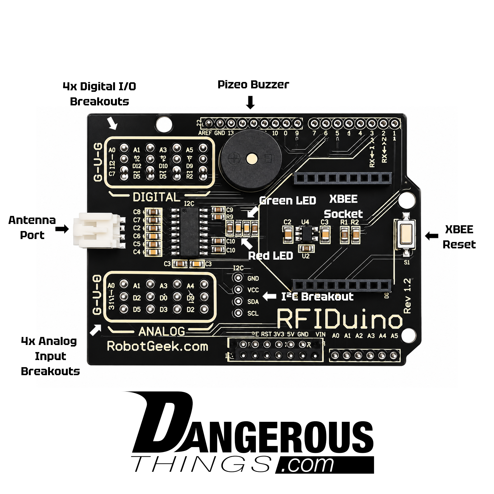

# RFIDuino Library for Arduino

You can install this library by copying the 'RFIDuino' folder into your 'libraries' folder.

### Pins Used by the RFIDuino 1.2
- Misc
  - Red LED (LED1): 8
  - Green LED (LED2): 4
  - Buzzer: 5
- EM4095
  - Ready Clock: 2
  - Demod: 3
  - Mod: 6
  - SHD (Sleep): 7
 
### Pins Available:
- Analog
  - 14-17
- Digital
  - 9-12
- 4-pin I²C Breakout

## Examples

Open these from **File → Examples → RFIDuino** in the Arduino IDE. Every example has a
`HARDWARE VERSION` line near the top: set it to match your shield (1.1 or 1.2).

### Getting started
| Example                                                        | What it does                                                                                                         |
| -------------------------------------------------------------- | -------------------------------------------------------------------------------------------------------------------- |
| [RFIDuino_output_test](RFIDuino/examples/RFIDuino_output_test) | Blinks both LEDs and the buzzer once a second. No tag needed: checks that the shield is seated and its outputs work. |
| [RFIDuino_helloWorld](RFIDuino/examples/RFIDuino_helloWorld)   | Prints each tag's 5-byte ID to the serial monitor, with a green light and beep. Start here to find your tags' IDs.   |

### Access control
| Example                                                                        | What it does                                                                                                     |
| ------------------------------------------------------------------------------ | ---------------------------------------------------------------------------------------------------------------- |
| [RFIDuino_demo1](RFIDuino/examples/RFIDuino_demo1)                             | Green light and success sound when one preset "key" tag is scanned.                                              |
| [RFIDuino_demo2_lockbox](RFIDuino/examples/RFIDuino_demo2_lockbox)             | Like demo1, but also pulses pin 9 to drive a relay or solenoid lock. Wrong tags get a red light and error sound. |
| [RFIDuino_demo3_lockbox_multi](RFIDuino/examples/RFIDuino_demo3_lockbox_multi) | demo2 with several key tags. Set `NUMBER_OF_CARDS` and list the IDs in `keyTag`.                                 |

These examples check a tag's ID, which identifies a tag but doesn't prove it's genuine: EM4100 IDs
are easy to copy. Fine for convenience and hobby projects; not a security barrier on its own.

### Other
| Example                                                      | What it does                                                                                                                                                          |
| ------------------------------------------------------------ | --------------------------------------------------------------------------------------------------------------------------------------------------------------------- |
| [RFIDuino_csv_logger](RFIDuino/examples/RFIDuino_csv_logger) | Prints one line per tag (its lower 4 bytes as a number) over serial, for logging with any serial terminal.                                                            |
| [RFIDuino_flashCards](RFIDuino/examples/RFIDuino_flashCards) | A matching game: scan a card, then its partner. Three tries before it resets. The tag IDs in the sketch are for one specific card set, so replace them with your own. |
| [RFIDuino_dutyCycle](RFIDuino/examples/RFIDuino_dutyCycle)   | Saves power by sleeping the reader between listening slots (`setDutyCycle(0.25)` = awake 1 slot in 4). The red LED shows when the reader is awake.                    |

### Running the tests

The tag-verification and duty-cycle logic has tests that run on your computer, no Arduino needed.
With `g++` installed, from the repo root:

    test/run.sh

They don't cover the radio itself, so check changes to tag reading on real hardware too.
